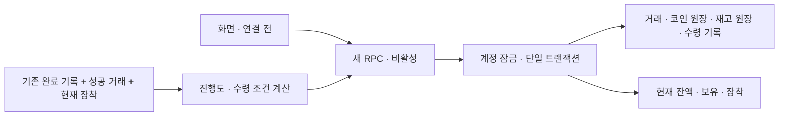

# 업적·코인·꾸미기 서버 설계

상태: 2026-11-05 서버 기반 구조와 신규 RPC 구현. 19개 업적의 진행도 계산·뽑기·조합·장착·수령·일일 과제 API를 추가한다. 기능은 비활성이며 기존 완료 API·운영 화면은 연결하지 않는다. 운영 적용 및 검증 결과는 [서버 작업 현황](achievement-server-status.md)에 기록한다.

## 1. 저장 원칙

Supabase/PostgreSQL 안에서 처리한다. 브라우저는 요청과 표시를 담당하고 판정·추첨·차감·지급은 서버의 한 트랜잭션에서 처리한다.

- 계정 키는 닉네임이 아닌 `auth.users.id`다. 기존 Google 로그인과 활성 학기 프로필 판정을 사용한다.
- 코인·보유 아이템·장착은 계정 전체에서 공유한다. 학기 변경이나 닉네임 변경으로 초기화하지 않는다. 차년도 업적 운영 방식은 추후 변경 가능하다.
- 문제 완료는 기존 완료 기록이 원본이다. 별도 업적 진행도·달성 권리·기능 누적 카운터 테이블은 만들지 않는다.
- 미션 수령·뽑기·조합 기록은 남긴다. 진행도와 수령 가능 여부는 원본 기록에서 계산한다.
- 소유 코인과 보유 수량은 조회·차감을 위해 현재 값도 저장한다. 원장 기록과 같은 트랜잭션에서 갱신하며 원장으로 검산·재구성할 수 있다.
- 거래 당시 비용·지급액·결과를 보관한다. 이후 설정 변경으로 과거 잔액을 다시 계산하지 않는다.
- 현재 장착 상태만 보관한다. 장착 이력은 만들지 않는다. 멋쟁이는 보상 수령 시 아이콘을 장착 중인지 확인한다. 받은 뒤 해제해도 보상은 유지한다.
- UI 시안의 sessionStorage, 가상 코인·재고·수령·사용 횟수는 운영 데이터로 이관하지 않는다.

## 2. 기존 구조와 연결

| 기존 데이터·함수 | 용도 |
|---|---|
| `public.semester_nicknames` | 활성 학기 프로필 확인 |
| `public.semester_completions` | 일반·난이도·유형·특수·전체 완료 판정 |
| `public.daily_sudoku_completions` | 데일리 연속·당일 완료·1등 판정 |
| `public.puzzle_catalog` | 공개 여부·난이도·문제 종류 |
| `private.calculate_daily_streak(...)` | 기존 하루 휴식 허용 규칙을 그대로 사용 |
| `public.submit_completion(...)` | 추후 완료 전후 판정을 비교해 새 달성을 응답에 포함 |
| `private.time_machine_wallets`, `private.time_machine_ticket_events` | 챔피언 보상은 기존 티켓 지갑 사용 |

기존 완료 API, RLS, 권한, 반환 형식과 기존 티켓 상한 제거 상태는 이번 서버 작업에서 바꾸지 않는다.

## 3. 확정 규칙

- 기본 뽑기: 커먼 72%·레어 24%·에픽 4%. 등급 안에서는 균등 추첨. 언커먼은 조합 전용이다.
- 커먼은 수량이 쌓인다. 다른 아이템은 영구 보유 1개다.
- 언커먼·레어 중복은 100코인, 에픽 중복은 500코인이다.
- 커먼 3개를 모두 소모한다. ABC는 AB·AC·BC를 균등 추첨하고, AAB는 AB, AAA는 A 단색 언커먼을 만든다. 버튼 실행 전 결과를 계산·제공하지 않는다.
- 언커먼은 두 재료 ID를 정렬해 동일 조합을 하나로 취급한다. 단색은 같은 ID 두 개다. 레어와 같은 색쌍이어도 서로 다른 아이템이다.
- 표현·방향은 아이템 종류를 늘리지 않는 장착 옵션이다. 기본색과 아이콘 없음은 보유 아이템이 아니다.
- 일반 에픽 효과는 언커먼·레어 위에만 적용한다. 별빛 반짝임은 현재 전체 완료 시에만 노출하는 독립 토글이며 모든 색에 적용 가능하고 뽑기에서 제외한다.
- 멋쟁이: 현재 아이콘 장착 → 옷걸이. 행운을 빌어요: 뽑기 5회 → 네잎클로버. 연금술사: 조합 5회 → 플라스크.
- 뽑기·조합은 이후 5회마다 같은 업적에서 코인을 받는다. 10회 뽑기는 10회로 센다. 실패·재전송은 횟수를 늘리지 않는다.
- 아이콘 지급 단계에는 코인을 함께 주지 않는다.
- 출석 체크 20코인, 하루 한 문제 100코인. 데일리 챔피언은 당일 데일리 1등에게 기존 타임머신 티켓을 지급한다.

출시 전 결정: 반복 업적 코인, 뽑기 가격, 챔피언 티켓 수량, 기존 기록 소급. 시안 가격·반복 보상은 운영 기본값으로 채택하지 않는다. 뽑기 설정은 가격 NULL의 초안으로만 준비한다.

## 4. 진행도와 수령 조건

| 업적 | 판정 원본 | 수령 범위 |
|---|---|---|
| 반가워요·퍼즐 수집가·난이도별 | 해당 학기 유효 일반 완료 | 사용자 + 학기 + 업적 + 목표 |
| 유형·특수 | 명시적 문제 ID 묶음과 유효 완료 | 사용자 + 학기 + 업적 + 목표 |
| 퍼스트 블러드 | 일반 문제 최초 완료자 | 사용자 + 학기 + 업적 + 1·3·10 |
| 꺼지지 않는 불 | 기존 규칙의 현재 연속 및 완료 날짜 기록 | 사용자 + 계정 + 7·14·21… |
| 멋쟁이 | 수령 시 현재 아이콘 장착 여부 | 사용자 + 계정 + 1 |
| 행운을 빌어요 | 완료된 뽑기 거래의 실제 결과 행 수 | 사용자 + 계정 + 5·10·15… |
| 연금술사 | 완료된 조합 거래 수 | 사용자 + 계정 + 5·10·15… |
| 일일 과제 | 서버 한국 날짜의 방문·유효 완료·당일 1등 | 사용자 + 날짜 + 과제 |

현재 데일리 연속은 기존 함수를 사용한다. 과거에 도달한 연속 단계는 유효 완료 날짜를 기존 규칙으로 재구성해 판정하며 별도 달성 이력을 남기지 않는다. 수령 기록은 유지하므로 끊겼다 다시 도달해도 같은 단계는 재지급하지 않는다. 타임머신 복원과 완료 제외 처리에 대한 집계 검증은 연결 단계에서 수행한다.

일반·데일리 완료는 `excluded=false`만 집계한다. 일반 문제는 공개된 문제만 포함한다. 유형은 제목 검색 대신 문제 ID를 명시적으로 연결하고 공개 문제가 3개 이상인 묶음만 활성화한다.

`scope_key`는 `account`, `season:2026-2`, `day:2026-11-05`처럼 명시한다. 규칙 버전을 수령 고유 키에 넣어 동일 단계 보상을 재지급하지 않는다.

## 5. 저장 구조

모두 private 스키마에 두고 RLS를 활성화한다. PUBLIC·anon·authenticated의 직접 접근과 내부 함수 실행 권한은 차단한다.

| 테이블 | 역할 |
|---|---|
| `cosmetic_settings` | 경제 기능 스위치. 최초 false |
| `cosmetic_items` | 커먼 36·레어 24·아이콘 21·뽑기 효과 5·전체 완료 효과 1의 정의 |
| `cosmetic_draw_configs` | 가격·확률·대상 목록의 버전. 버전 1은 가격 미정의 draft. 한 번 활성화한 정의는 변경 불가 |
| `account_coin_wallets` | 현재 코인·계정 상태 revision. 사용자에게 자동 생성·지급하지 않음 |
| `cosmetic_inventory` | 현재 보유 수량. 커먼 외 수량 1, 커먼 0이면 행 삭제 |
| `cosmetic_equipment` | 현재 아이콘·색깔·효과·표현·방향·장착 버전 |
| `account_operations` | 경제 요청의 UUID·정규화 입력·설정 버전·확정 응답·처리 버전 |
| `coin_ledger` | 거래별 코인 증감·원인·변경 후 잔액 |
| `inventory_ledger` | 거래별 아이템 증감·원인·변경 후 수량 |
| `cosmetic_results` | 뽑기·조합의 순서별 실제 결과·중복·환급액 |
| `mission_claims` | 단계별 단 한 번의 수령과 실제 지급 보상 스냅샷. 데일리도 날짜 범위로 사용 |
| `site_visits` | 한국 날짜별 출석 원본. 새 방문 API에서만 기록 |
| `achievement_rules`, `achievement_stage_rewards` | 업적 지표·범위·목표·보상 아이템·반복 간격·반복 코인 설정 |
| `achievement_puzzle_bindings` | 유형·특수 문제의 명시적 ID 연결 |
| `puzzle_first_finishers` | 기존 일반 최초 완료자의 고정 기록. 탈퇴 시 사용자만 익명화 |

계정 데이터는 계정 삭제 시 CASCADE로 정리한다. 아이템 정의와 설정은 계정과 독립적이다. 영구 아이템 소모는 내부 재고 함수에서도 거절한다. 원장 수정 대신 새 보정 거래를 남긴다.

달성 권리 테이블, 기능 누적 카운터, 장착 이력은 만들지 않는다. 규칙·문제 묶음 연결·기존 최초 완료자 고정 구조를 추가했다. 미래 완료 시점의 최초 완료자 확정 연결은 기존 완료 API 통합 단계에서 수행한다.

## 6. 내부 거래 함수

새 RPC가 동일 DB 트랜잭션에서 사용하는 기반 함수다. 내부 함수 직접 호출 권한은 공개하지 않는다.

1. `private.begin_cosmetic_operation(request_id, kind, payload)`
   - Google 로그인·활성 학기 프로필·비활성 스위치를 검사한다.
   - 계정 지갑을 잠가 병렬 요청의 잔액·재고 갱신을 직렬화한다.
   - 같은 UUID와 같은 입력의 완료 거래는 기존 응답을 재사용한다. 다른 입력은 거절한다.
2. `private.change_cosmetic_coins(operation_id, delta, reason)`
   - 미완료 거래에서만 실행한다. 음수 잔액을 막고 지갑과 코인 원장을 함께 바꾼다.
3. `private.change_cosmetic_inventory(operation_id, item_id, delta, reason)`
   - 재료 부족·영구 아이템 중복 수량·영구 아이템 소모를 거절한다. 보유와 원장을 함께 바꾼다.
4. `private.finish_cosmetic_operation(operation_id, response)`
   - revision을 증가시키고 확정 응답을 보관한다. 완료 뒤에는 추가 원장 기록을 받지 않는다.

커밋 시점에 pending 거래가 남으면 신규 테이블의 지연 제약 트리거가 전체 거래를 거절한다. 도중 오류가 나면 트랜잭션을 롤백한다. 재고 함수 자체는 중복을 코인으로 바꾸지 않는다. 뽑기·조합·수령 함수에서 중복을 판정해 코인 함수 또는 재고 함수 중 하나를 호출한다.

## 7. 신규 공개 API

모든 사용자 ID는 `auth.uid()`에서 결정한다. 클라이언트는 금액·등급·난수·보상 내용을 지정하지 못한다.

| 구현한 RPC | 내용 |
|---|---|
| `achievement_context()` | 실제 진행도·수령 상태·한국 날짜·일일 과제 |
| `cosmetic_context()` | 보유·장착·가격·확률·코인·버전 |
| `record_site_visit(request_id)` | 서버 한국 날짜별 한 번 방문 기록 |
| `set_cosmetic_equipment(expected_equipment_version, equipment)` | 보유·아이템 종류·효과 적용·옵션 검증 후 현재 선택 갱신. 장착 이력 없음 |
| `draw_cosmetics(request_id, expected_draw_config_version, count)` | 서버 난수·차감·결과·중복 환급을 원자 처리 |
| `craft_cosmetic(request_id, material_ids)` | 정확히 커먼 3개 검증·소모·추첨·중복 환급 |
| `claim_achievement(request_id, achievement_id, scope_key, threshold)` | 수령 시 원본 조건을 검증하고 지급·수령 기록을 함께 저장 |
| `claim_daily_task(request_id, task_key, target_day)` | 당일 조건·날짜·미수령 확인 후 코인 또는 기존 티켓 지급 |
| `cosmetic_operation(request_id)` | 타임아웃 후 본인 확정 거래 조회 |

장착은 별도 버전으로 충돌을 처리한다. 장착만 바꾼 경우 경제 거래 이력을 남기지 않는다. 경제 응답에는 전체 보유·잔액과 state_revision을 포함하고, 장착은 equipment_version으로 별도 비교한다. 오래된 경제 응답이 더 최근 장착을 덮어쓰면 안 된다.

병렬 1회 뽑기는 허용한다. 계정 잠금 후 잔액을 검사하고 결과는 거래 순서대로 누적한다. 응답 역전 시 상태는 최신 버전만 반영하되 미표시 결과는 누락하지 않는다. UI 결과 목록은 새로고침 때 비워도 서버 기록은 유지한다.

가격·확률 버전이 바뀐 뽑기는 차감 없이 CONFIG_CHANGED로 거절한다. 한 번 활성화한 버전은 가격·확률·대상 목록을 수정하거나 draft로 되돌릴 수 없으며 새 버전으로 교체해야 한다. 난수는 설치된 `extensions.gen_random_bytes`와 나머지 편향을 제거한 범위 추출로 구현했다. 등급 내 각 아이템도 균등하게 선택한다.

## 8. 완료 API와 알림

원본 기록으로 판정하므로 완료 시 별도 업적 상태를 갱신하지 않는다. 새 완료의 삽입 전후 판정을 비교해 새 달성을 기존 응답에 추가하면 토스트를 띄울 수 있다. 중복 제출은 새 달성 알림을 다시 만들지 않는다. 토스트 표시를 위한 DB 기록은 추가하지 않는다.

이 연결은 기존 완료 API를 바꾸는 별도 배포다. 현재 호출 서명·기존 응답 필드·중복 제출·타임머신 처리를 보존해야 한다. 판정 함수 오류가 완료 저장까지 롤백할 수 있으므로 먼저 독립 검증한다.

일반 퍼스트 블러드는 기존 최초 완료자를 고정하고, 이후 미확정 문제는 원본 기록에서 임시 집계한 뒤 수령 시 고정한다. 활성화 전 기존 완료 API의 일반 완료 분기에 퍼즐 공통 잠금과 `private.capture_puzzle_first_finisher` 호출을 연결해야 한다. 이 연결로 수령 전 탈퇴·동시 완료에서도 최초 완료 사실을 보존한다. 최초 사용자가 탈퇴해도 다음 사람에게 1등을 넘기지 않는다. 시안용 완료 기록이나 익명 닉네임을 계정에 임의로 연결하지 않는다.

하루 한 문제는 한국 날짜에 실제 새로 저장한 일반 또는 데일리 완료를 원본에서 찾는다. 출석만 별도 방문 기록을 남긴다. 과거 데일리를 타임머신으로 새로 완료한 경우도 포함하는 것을 기본안으로 둔다. 데일리 보상은 당일 수령만 허용하는 것을 기본안으로 둔다.

챔피언은 당일 데일리 rank=1과 유효 완료를 확인한다. 과거 데일리 1등으로 당일 티켓을 받지 못한다. 새 내부 함수 `private.award_cosmetic_tickets`가 기존 초기 티켓 지급을 보존한 뒤 티켓 수만큼 delta=1, day=NULL 이벤트를 기록한다. 고유 이벤트 키는 `cosmetic:<operation_id>:<index>`다. 지갑·기존 티켓 원장·미션 수령 기록은 같은 트랜잭션에 포함된다. 기존 티켓 함수·테이블 제약은 수정하지 않는다.

전체 완료는 도전과제·수령 대상에서 제외한다. `private.all_clear_status`가 현재 공개 문제 집합과 본인의 유효 완료를 비교한다. `cosmetic_equipment.all_clear_enabled`는 독립적인 선택이고 eligibility와 분리해 보존한다. 새 문제 공개로 미달성 상태가 되면 항목과 적용을 숨기고, 다시 모두 풀면 이전 선택으로 복원한다. 일반 효과와 중첩할 수 있고 기본색·커먼에서도 허용한다. 공개 랭킹을 연결할 때도 현재 자격과 저장된 선택을 함께 판정해야 한다.

## 9. 적용 순서와 검증

1. 기반 구조·아이템 정의·내부 거래 함수를 비활성 상태로 적용했다.
2. 규칙·문제 ID 연결·진행도 조회·장착·뽑기·조합·수령 RPC를 구현하고 거래 검증을 수행했다. 신규 API는 모든 호출에서 비활성 스위치를 검사한다.
3. 가격·반복 보상·티켓·소급 정책을 확정한다. 미정 항목은 지급 경로를 열지 않는다.
4. 기존 완료 응답에 새 달성 알림을 연결한다. 기존 정상·중복·과거 데일리 완료를 검증한다.
5. 실제 마이페이지·꾸미기·랭킹에 연결하고 기능 스위치를 활성화한다.

검증: 비활성 요청 무변경, 동일 요청 재현, 입력 바꾼 재사용 거절, 잔액·재고 음수 차단, 영구 보유 제약, 동일 보상 중복 수령 차단, 원장과 현재 값 일치, 미완료 거래 커밋 차단, private 권한과 계정 삭제. RPC 롤백 검증과 격리된 PostgreSQL의 실제 병렬 호출 검증을 수행한다. 기존 완료 API 연결 이후에는 완료 재전송·타임머신·토스트를, 프런트엔드 연결 이후에는 계정 전환·자정 전환·응답 역전의 화면 처리를 추가 검증한다.

구체적인 요청·응답과 설정 방법은 [API 계약](achievement-api-contract.md), 운영 적용 및 검증 현황은 [서버 작업 현황](achievement-server-status.md)을 따른다.
