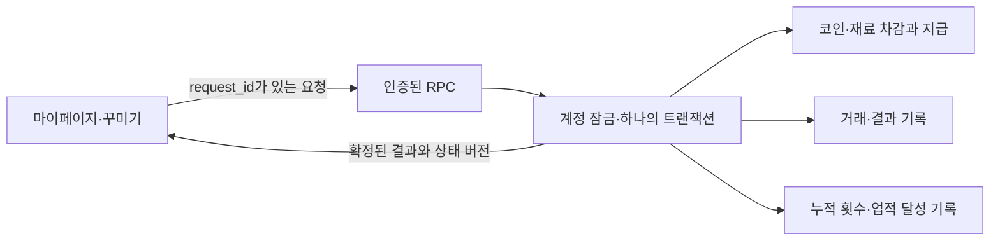

# 업적·코인·꾸미기 서버 설계

상태: 실제 구현을 위한 설계안. 이 문서 작성으로 운영 DB나 기존 API는 변경하지 않는다. UI 시안의 가상 데이터와 운영 데이터는 이관하지 않는다.

## 1. 구현 방향

현재 Supabase/PostgreSQL 구조에 RPC를 추가한다. 별도 게임 서버나 작업 큐는 두지 않는다. 브라우저는 요청과 표시를 담당하고, 달성 판정·추첨·차감·지급·중복 처리는 DB 트랜잭션 안에서 끝낸다.

- 계정 식별자는 닉네임이 아닌 `auth.users.id`다. 기존 Google 로그인 판정을 재사용한다.
- 코인·보유 아이템·장착 설정은 계정 전체에서 유지한다. 학기가 바뀌거나 닉네임을 바꿔도 유지한다.
- 기존 문제 완료 테이블을 원본으로 사용한다. 업적을 위해 별도 완료 제출이나 정답·유일성 검증을 추가하지 않는다.
- 뽑기·조합의 서버 거래 기록은 남긴다. 화면 결과 목록만 페이지를 벗어나면 비운다.
- 진행률(%)은 저장하지 않는다. 원본 완료 기록, 기능 사용 횟수, 달성한 단계와 수령 기록으로 계산한다.
- 코인 보상량은 아직 확정 전이다. 시안의 60·80·90·100·120 등을 운영 기본값으로 자동 채택하지 않는다.



## 2. 기존 구조와 연결 지점

| 기존 코드·데이터 | 사용 방법 |
|---|---|
| `public.semester_nicknames` | 활성 학기의 프로필 존재 여부 확인. 닉네임을 새 경제 데이터의 키로 쓰지 않음 |
| `public.semester_completions` | 일반 완료 수·난이도·문제 묶음·특수 문제·전체 완료의 원본 |
| `public.daily_sudoku_completions` | 데일리 완료·순위·제외 여부의 원본 |
| `public.submit_completion(...)` | 새 완료가 실제 삽입된 분기에만 업적·당일 과제 처리를 연결. 기존 기록을 반환하는 재요청에는 중복 처리하지 않음 |
| `public.puzzle_catalog` | 공개 여부·난이도·문제 종류 확인. `draft`·`test`·미래 공개는 제외 |
| `private.calculate_daily_streak(...)` | 현재 데일리 연속 수치를 그대로 사용. 쉬는 하루를 허용하는 기존 규칙을 별도 구현으로 대체하지 않음 |
| `private.time_machine_wallets`, `private.time_machine_ticket_events` | 데일리 챔피언 보상의 기존 티켓 지갑과 지급 이력. 별도 티켓 종류·지갑을 만들지 않음 |
| `window.puzzleAccount.client.rpc(...)` | 기존 인증 클라이언트를 사용. 응답 전후 계정이 바뀌면 응답 적용 중단 |

확인한 기준 파일:

- [계정 연결](../supabase/migrations/20260916_google_accounts.sql)
- [완료 기록 권한·제외 상태](../supabase/migrations/20260917_completion_states.sql)
- [문제 공개·관리](../supabase/migrations/20261001_puzzle_management.sql)
- [완료 제출·타임머신](../supabase/migrations/20261011_time_machine.sql)
- [티켓 상한 제거](../supabase/migrations/20261024_remove_time_machine_ticket_cap.sql)
- [데일리 연속 계산](../supabase/migrations/20260919_daily_streak.sql)
- [데일리 클라이언트](../src/lib/daily-sudoku-client.js)

기존 API를 수정할 때는 최신 정의를 기준으로 한다. 특히 티켓 잔액에 과거의 최대 2장 제한을 다시 넣지 않는다.

## 3. 확정 규칙과 출시 전 결정

### 그대로 구현할 규칙

- 기본 뽑기: 커먼 72%·레어 24%·에픽 4%. 언커먼은 기본 뽑기에서 나오지 않는다.
- 커먼: 보유 수량이 쌓이고 조합 시 소모된다.
- 언커먼·레어: 최초 1개만 보유한다. 중복이면 추가 아이템 대신 100코인을 받는다.
- 에픽 효과: 최초 1개만 보유한다. 중복이면 500코인을 받는다.
- 조합: 커먼 세 개 모두 소모. ABC는 AB·AC·BC가 각각 1/3, AAB는 AB 확정, AAA는 A 단색 언커먼 확정.
- 결과는 조합하기를 누른 뒤 정한다. 선택 단계에는 결과나 중복 보상 여부를 알려주지 않는다.
- 아이콘·색깔·효과는 선택 즉시 적용한다. 아이콘 해제 가능. 효과는 언커먼 이상 색깔에만 적용한다.
- 멋쟁이: 명시적 아이콘 장착 1회 → 옷걸이. 행운의 손: 뽑기 5회 → 네잎클로버. 연금술사: 조합 5회 → 플라스크.
- 뽑기·조합은 이후 5회마다 같은 업적에서 코인 보상. 10회 뽑기는 사용 횟수 10으로 센다.
- 아이콘 지급 단계에는 코인을 함께 주지 않는다.
- 출석 체크 20코인, 하루 한 문제 100코인. 데일리 챔피언은 당일 데일리 스도쿠 1등에 대한 기존 타임머신 티켓 보상.

### 출시 전 확정할 값

1. 반복 업적별 코인 지급량.
2. 기본 뽑기 가격. 현재 시안은 1회 100·10회 1,000이며 할인·확정 보너스는 없다.
3. 데일리 챔피언 티켓 수량. 현재 시안은 1장이다.
4. 기존 기록 소급과 달성 보상 보존 정책.

금액 미정 항목은 설정의 초안 상태로 둔다. 출시하려면 사용 중인 보상·가격 설정 버전을 먼저 확정해야 한다. 예시 페이지의 코인 1,240이나 가상 아이템을 운영 계정에 지급하지 않는다. 초기 운영 잔액은 0을 기본안으로 둔다.

## 4. 업적 범위와 진행도

이번 구현은 다음 범위를 기준으로 진행한다. 계정 전체의 코인·보유·장착과 학기별 문제 업적을 분리하며, 차년도 운영 방식은 추후 변경할 수 있다.

| 업적 | 판정 원본 | 보상 수령 범위 |
|---|---|---|
| 첫걸음·퍼즐 수집가·난이도별 | 해당 학기의 공개 일반 문제 중 본인 완료 기록 | 사용자 + 학기 + 업적 + 단계 |
| 퍼스트 블러드 | 일반 문제별 최초 완료자 기록 | 사용자 + 학기 + 업적 + 1·3·10회 |
| 문제 묶음·특수 문제 | 명시적으로 연결된 공개 문제의 본인 완료 기록 | 사용자 + 학기 + 업적 + 단계 |
| 완전 정복 | 해당 학기 공개 일반 문제 전체의 본인 완료 여부 | 사용자 + 학기 + 업적 |
| 꺼지지 않는 불 | 기존 함수의 현재 데일리 연속 수치 | 사용자 + 계정 범위 + 7·14·21… |
| 멋쟁이·행운의 손·연금술사 | 서버에서 성공 처리된 장착·뽑기·조합 | 사용자 + 계정 범위 + 단계 |
| 데일리 과제 | 서버 한국 날짜별 출석·완료·당일 1등 | 사용자 + 한국 날짜 + 과제 |

- `scope_key`는 `account`, `season:2026-2`, `day:2026-11-05`처럼 명시한다. nullable 복합 키로 중복 수령 제한을 만들지 않는다.
- 기존 일반 문제 완료·순위는 다시 브라우저가 보고하지 않는다. 일반·데일리 모두 `excluded=false`인 유효 완료만 집계한다. 초기에는 원본 테이블을 사용자별 인덱스로 집계하는 방식으로 충분하다.
- 기능 횟수만 `account_action_totals`에 유지한다. 최초 장착은 1로 고정, 뽑기는 지급 개수만큼, 조합은 성공 1건당 1 증가한다.
- 잔액 부족·재료 부족·재요청·아이콘 없음·화면 렌더링은 사용 횟수에 포함하지 않는다. 중복 환급이 발생한 정상 뽑기·조합은 포함한다.
- 반복 업적은 마지막 정적 단계에 도달했다고 완료 처리하지 않는다. 다음 미수령 목표를 간격 규칙으로 계산한다.
- 아이콘은 계정 전체에서 한 번만 소유한다. 다른 학기에서 같은 보상 아이콘을 다시 달성해도 아이콘 단계에서 코인을 대신 지급하지 않는다.
- 문제 묶음은 제목 문자열 검색으로 분류하지 않고 문제 ID를 연결한다. 스타배틀의 여러 변형은 같은 업적에 연결한다. 공개 대상이 세 개 이상인 묶음만 활성화한다.

### 현재 수치와 이미 달성한 보상은 구분

특히 데일리 연속 수치는 떨어질 수 있다. 14에 도달한 순간 14단계의 달성 권리를 기록해두고, 수령 전에 연속 기록이 끊겨도 이미 달성한 보상을 없애지 않는 방식을 권장한다.

- 새 달성 판정은 최장 연속이 아닌 현재 연속 수치로 한다.
- 이미 달성한 단계는 `achievement_entitlements`에 남긴다.
- 수령한 단계는 다시 달성해도 재지급하지 않는다.
- 현재 수치가 2더라도 미수령 달성 단계가 있으면 API는 `claimable`을 반환하고 UI는 `달성`으로 표시한다. 현재 수치를 임의로 14로 바꾸지 않는다.
- 하루가 바뀌면 조회 시 현재 연속 수치를 다시 계산한다. 새 완료·타임머신 완료가 들어올 때도 동일 함수를 호출한다.

퍼즐 분류·공개 상태가 바뀌면 현재 집계는 갱신하되, 이미 기록된 달성 권리와 지급 내역을 자동 삭제하지 않는다. 완료 제외나 운영 오류로 보상을 취소해야 할 경우는 별도 운영 보정으로 처리한다.

## 5. 저장 구조

모든 경제·업적 변경 테이블은 `private` 스키마에 두고 클라이언트의 직접 INSERT·UPDATE·DELETE를 막는다. ID나 스키마 이름은 구현 시 마이그레이션에서 확정한다.

| 테이블 | 주요 열·제약 | 역할 |
|---|---|---|
| `cosmetic_items` | `id` PK, 종류, 등급, 색/아이콘/효과 정의, 생성 방식, 활성 여부 | 신뢰할 수 있는 아이템 정의. 이름을 ID로 사용하지 않음 |
| `cosmetic_draw_configs` | 버전 PK, 확률 정수 가중치, 등급별 아이템 목록, 가격, 활성 여부 | 한 거래에서 사용할 확률·가격·대상 목록 고정 |
| `account_coin_wallets` | `user_id` PK/FK, `balance bigint CHECK >=0`, `revision bigint` | 잔액과 응답 정렬용 계정 상태 버전 |
| `cosmetic_inventory` | PK `(user_id,item_id)`, `quantity >0` | 커먼 수량과 영구 아이템 소유. 영구 아이템은 수량 1만 허용 |
| `cosmetic_equipment` | `user_id` PK, `equipment_version`, nullable 아이콘, 색깔, nullable 효과, 표현·방향 | 현재 표시 설정. 기본색은 별도 시스템 기본값 |
| `account_operations` | UNIQUE `(user_id,request_id)`, 요청 종류·정규화 요청 해시·결과 JSON·설정 버전·처리 순서 | 재요청 방지와 성공/업무 실패 응답 재현 |
| `coin_ledger` | UNIQUE `(operation_id,line_no)`, 사용자, 원인, `delta`, `balance_after` | 차감·보상·중복 환급을 구분한 코인 원장 |
| `inventory_ledger` | 거래 ID, 항목 번호, 아이템 ID, 수량 변화, 변경 후 수량 | 재료 소모와 최초 획득 추적 |
| `cosmetic_results` | PK `(operation_id,item_index)`, 아이템, 신규/중복, 환급액 | 뽑기·조합 결과. 10회 내 중복도 각각 한 행 |
| `account_action_totals` | PK `(user_id,action_key)`, 누적 횟수 | 실제 성공 동작 횟수. 거래 기록에서 재계산 가능 |
| `achievement_rules` | 논리 업적 ID·설정 버전, 지표, 범위, 최초·반복 목표, 보상 | 문구와 판정·보상 설정 분리 |
| `achievement_puzzle_bindings` | 업적 ID, 학기, 문제 ID, 적용 버전 | 묶음·특수 문제의 명시적 연결 |
| `achievement_entitlements` | UNIQUE `(user_id,scope_key,achievement_id,threshold)`, 달성 시각·보상 스냅샷, 수령 시각·거래 ID | 달성 권리와 단 한 번의 지급 |
| `daily_activity` | PK `(user_id,day)`, 방문 시각, 최초 유효 완료 참조 | 출석·하루 한 문제의 한국 날짜별 원본 |
| `puzzle_first_finishers` | PK `(season_id,puzzle_id)`, 최초 완료자·완료 시각 | 동시 완료와 재정렬에 흔들리지 않는 일반 퍼스트 블러드 |

규칙:

- `user_id`는 `auth.users(id)`를 참조하고 계정 삭제 정책은 기존 계정 삭제 흐름과 일치시킨다. 본인 경제·업적 데이터는 기본적으로 `ON DELETE CASCADE`로 정리한다. 단, `puzzle_first_finishers`는 퍼즐의 최초 완료 사실이므로 계정 삭제 시 사용자 참조만 `SET NULL`로 익명화하고 행과 시각은 유지한다. 탈퇴 후 다른 사람을 새 1등으로 만들지 않는다.
- 커먼 재고가 0이 되면 행을 삭제한다. 언커먼·레어·아이콘·효과는 영구 소유이며 조합 재료로 사용하지 않는다. 아이템 종류를 복합 외래 키로 재고 행과 연결해 `common_color` 외에는 수량이 1이라는 CHECK도 DB에서 강제한다.
- 임의 조합 언커먼의 키는 재료 두 색 ID를 정렬한 `uncommon:<a>:<b>`로 만든다. 단색은 `a=a`. 선택 순서나 화면 이름으로 중복 판정을 달리하지 않는다. 정규화 색쌍은 종류와 함께 UNIQUE 제약을 두어 동시 생성도 같은 아이템으로 합쳐진다.
- 고정 레어와 자유 조합 언커먼은 같은 색쌍이어도 별도 아이템이다. 언커먼 두 개의 중복은 같은 정규화 색쌍으로 판정한다.
- 아이콘 해제는 nullable 아이콘으로 표현한다. `none`이라는 가짜 보유 아이템을 만들지 않는다.
- 원장과 처리 결과를 브라우저가 덮어쓰거나 삭제하지 못하게 한다. 운영 보정도 원래 기록을 수정하는 대신 반대 금액의 보정 거래로 남긴다.
- 달성·수령 키에 설정 버전을 포함해 같은 보상을 다시 받게 만들지 않는다. 버전은 보상 스냅샷의 해석·감사용이다.

## 6. API 계약

모든 변경 RPC는 사용자 ID를 인자로 받지 않고 `auth.uid()`에서 결정한다. `request_id`는 클라이언트가 동작마다 생성한 UUID다. 네트워크 재전송에는 같은 UUID를 재사용한다.

| RPC | 입력 핵심 | 응답 핵심 |
|---|---|---|
| `achievement_context()` | 없음 | 서버 한국 날짜, 잔액·상태 버전, 업적 현재 수치·목표·달성/수령 상태, 당일 과제 |
| `cosmetic_context()` | 없음 | 아이템 정의 버전, 본인 재고·장착, 확률·가격, 잔액·상태 버전 |
| `record_site_visit(request_id)` | 요청 ID | 오늘 출석 달성 상태. 같은 날 중복 기록 없음 |
| `set_cosmetic_equipment(request_id, expected_equipment_version, equipment)` | 전체 장착 설정 | 검증된 장착·새 상태 버전, 멋쟁이 진행도 |
| `draw_cosmetics(request_id, expected_draw_config_version, count)` | 표시한 설정 버전, 1 또는 10 | 처리 순서, 결과 배열, 신규/중복·환급액, 최신 잔액·재고·업적 상태 |
| `craft_cosmetic(request_id, material_ids)` | 커먼 ID 정확히 세 개, 중복 허용 | 실제로 추첨한 언커먼 결과 1개, 소모·환급·장착·업적 변화 |
| `claim_achievement(request_id, achievement_id, scope_key, threshold)` | 수령할 논리 단계 | 실제 지급한 보상, 이미 지급 여부, 잔액·재고·다음 목표 |
| `claim_daily_task(request_id, task_key, target_day)` | 당일 과제 종류·날짜 | 실제 코인/티켓 보상과 수령 상태 |
| `cosmetic_operation(request_id)` | 본인 요청 ID | 타임아웃 후 이미 처리된 결과 확인 |

- 새 코인 지급량·아이템·추첨 확률·재료 수량을 클라이언트가 지정하지 못한다.
- 존재하지 않는 아이템, 미보유 아이템, 조합 불가능한 등급, 재고 부족, 효과 적용 불가 색깔, 허용되지 않은 표현·방향은 서버에서 거절한다.
- 장착은 `expected_equipment_version` 충돌 시 최신 상태를 받아 다시 선택한다. 장착 버전은 장착 또는 조합의 자동 적용 때만 증가한다. 코인 잔액만 바뀌었다는 이유로 정상 장착 요청을 거절하지 않는다.
- 뽑기는 재고를 소모하는 명령이므로 오래된 잔액 버전만으로 거절하지 않는다. 계정 잠금 뒤 실제 잔액으로 판정한다.
- 변경 후 응답에는 `state_revision`, `operation_id`, `operation_sequence`, 확정된 결과를 포함한다. 초기 구현은 지갑·전체 재고·장착·기능 횟수의 상태 스냅샷을 반환한다. 역순 응답에서 변경분만 버려 일부 재고가 누락되는 상황을 만들지 않는다.
- 조회 RPC도 잔액 버전과 재고·장착을 일관된 SQL 스냅샷에서 읽는다. 가격·확률 설정 버전이 바뀌었으면 뽑기를 차감 없이 `CONFIG_CHANGED`로 거절하고 화면 설정을 갱신한다.

예시 응답 형태:

```json
{
  "ok": true,
  "operation_id": "...",
  "operation_sequence": 42,
  "state_revision": 42,
  "wallet": {"coins": 420},
  "results": [
    {"item_id": "rare:berry", "duplicate": true, "refund_coins": 100}
  ],
  "progress": {"draw_count": 12},
  "achievements": [
    {"id": "lucky-hand", "current": 12, "next_threshold": 15, "state": "in_progress"}
  ]
}
```

## 7. 한 거래의 처리 순서

### 공통 원칙

1. 로그인·프로필·요청 형식을 확인한다.
2. 해당 요청의 기존 확정 결과가 있으면 요청 해시를 비교해 그대로 반환한다.
3. 필요한 기존 퍼즐/날짜 잠금 후 계정 코인 지갑을 `FOR UPDATE`로 잠근다. 잠금을 얻은 뒤 요청 이력을 다시 확인한다.
4. 기존 완료 기록을 다루는 RPC의 잠금 순서를 역전시키지 않는다. 기본 순서는 퍼즐/데일리 날짜 → 코인 지갑 → 타임머신 지갑이다. 새 경제 RPC에서 지갑을 잠근 뒤 `submit_completion` 같은 공개 RPC를 다시 호출하지 않는다.
5. 실제 상태로 조건을 확인하고 차감·지급·원장·사용 횟수·달성 단계를 함께 반영한다.
6. 상태 버전을 증가시키고 응답을 저장한 뒤 커밋한다. 애니메이션은 응답을 받은 뒤 시작한다.

같은 계정의 소비·지급·수령은 같은 지갑 행 잠금으로 직렬화한다. 계정 간에는 독립적으로 처리한다. 일일 1등 판정은 기존 날짜 잠금, 일반 퍼스트 블러드는 퍼즐별 잠금과 UNIQUE 제약으로 별도 직렬화한다.

잔액·재료 부족 같은 업무 오류는 아이템과 코인을 변경하지 않은 실패 응답으로 저장한다. 같은 요청 ID의 재시도는 그 실패를 반환한다. 사용자가 다시 시도할 때만 새 요청 ID를 만든다. 인증 실패나 예기치 못한 DB 오류는 정상 거래처럼 기록하지 않는다. 예외로 롤백된 요청은 같은 ID로 재시도할 수 있다.

### 뽑기

1. count가 1 또는 10인지 검사하고 현재 활성 설정 버전을 고정한다.
2. 화면에서 확인한 설정 버전이 여전히 유효하고 환급 전 잔액이 전체 비용 이상인지 확인한다. 10회 비용을 중간 중복 환급으로 충당하게 하지 않는다.
3. 전체 비용을 차감한다.
4. 서버에서 각 아이템을 순서대로 추첨한다.
5. 앞선 결과까지 반영된 소유 상태로 신규/중복을 판정한다. 같은 10회 안에서도 두 번째 동일 레어·에픽부터 환급한다.
6. 소유/수량, 개별 결과, 차감·환급 원장, 뽑기 횟수 +count, 새 달성 단계를 같은 거래에서 저장한다.
7. 최종 잔액과 모든 결과를 반환한다. 재요청은 다시 추첨하지 않는다.

추첨은 서버의 암호학적 난수로 한다. 정수 범위 추출은 나머지 연산 편향이 없게 구현한다. 기본 등급은 0…9,999에서 7,200/2,400/400 구간으로 결정하고, 등급 안에서는 균등하게 뽑는다. 실제 마이그레이션에서는 설치된 pgcrypto의 스키마·권한을 먼저 확인하고 내부 난수 함수를 고정한다. 브라우저 `Math.random()` 값은 입력으로 받지 않는다.

### 조합

1. 커먼 세 개와 실제 보유 수량을 검사한다. 같은 ID 세 개도 수량이 3 이상이어야 한다.
2. 서로 다른 색 수를 판별한다. ABC일 때만 세 색쌍 중 하나를 균등 추첨한다. AAB는 AB, AAA는 AA다.
3. 입력 세 개를 모두 소모하고, 정규화된 언커먼을 지급하거나 중복 100코인을 지급한다.
4. 조합 횟수 +1, 결과·재고·원장·달성 기록을 함께 저장한다.
5. 현재 시안과 같이 결과 색을 장착 설정에 적용하는 것을 기본안으로 둔다. 중복이라도 기존 보유 언커먼을 적용한다. 아이콘이 해제된 경우에는 색 설정만 보관한다.

결과를 미리 반환하는 API나 중복 여부 미리보기 API는 만들지 않는다. 확인 버튼 전에는 재료·보유 수량·실행 가능 여부만 표시한다.

### 업적 보상 수령

달성 권리를 잠그고 미수령인지 확인한 뒤 보상을 지급한다. 코인·아이콘·효과·기존 티켓 중 설정된 종류만 지급한다. 최초 아이콘 단계에 코인을 추가하지 않는다. 지급과 `claimed_at` 기록은 같은 거래다. 요청 ID가 달라도 같은 단계 UNIQUE 키로 두 번 받을 수 없다.

누적 12회라면 5회 아이콘과 10회 코인을 차례로 수령하고 다음 목표가 15회가 된다. 현재 UI처럼 받기는 한 단계씩 처리한다. 단계별 수령 후 행 위치는 유지하고 다음 진입 시 정렬한다.

## 8. 완료·데일리·퍼스트 블러드 연결

### 일반·데일리 완료

일반·데일리 완료 테이블의 기존 클라이언트 직접 쓰기 차단은 유지한다. 기존 `submit_completion`에서 실제 INSERT에 성공한 분기만 내부 업적 함수를 호출한다. 중복 제출의 기존 결과 반환 경로는 새로운 완료나 사용 횟수를 만들지 않는다. 내부 함수는 클라이언트가 직접 호출할 수 없다.

- 일반 완료는 현재 학기의 공개 문제만 집계한다. 기존 서버 완료 판정 계약은 유지한다.
- 새 일반 완료 뒤에는 일반·난이도·묶음·특수·전체 완료를 갱신한다.
- 새 데일리 완료 뒤에는 기존 현재 연속 계산과 관련 달성 기록을 갱신한다.
- 문제 타입·난이도·공개 상태 수정 시 해당 지표를 재계산하고 누락된 달성 권리를 보충한다. 이미 기록된 권리는 자동 회수하지 않는다.

### 출석과 하루 한 문제

- 출석은 로그인 상태의 실제 방문에서 `record_site_visit`을 호출한다. 서버의 한국 날짜에 사용자별 한 번만 기록한다. 새로고침은 출석 수나 보상을 늘리지 않는다.
- 하루 한 문제는 해당 한국 날짜에 새로 등록된 일반 또는 데일리 완료를 기준으로 한다. 같은 기존 완료의 재전송으로 달성할 수 없다.
- 타임머신으로 과거 데일리를 새로 완료한 것도 하루 한 문제에 포함하는 것을 기본안으로 둔다. 과거 기록 복원 자체는 제외한다.
- 데일리 보상은 해당 한국 날짜에만 수령할 수 있고 다음 날로 이월하지 않는 것을 기본안으로 둔다. 클라이언트 날짜로 수령 날짜를 바꿀 수 없다.

### 데일리 챔피언

당일 데일리의 최초 완료자에게만 달성 권리를 만든다. 과거 데일리의 1등을 타임머신으로 달성해 현재 날짜의 보상을 받을 수 없다. 수령 시 기존 타임머신 지갑에 티켓을 넣고, 기존 티켓 원장에는 `daily-champion:<day>`라는 고유 지급 키를 사용한다. 최초 지급과 이미 지급 여부를 같은 트랜잭션에서 확인한다.

다른 사용자가 먼저 완료한 날에는 `unavailable`과 `기회 종료`를 반환한다. 완료 제외로 1등이 바뀌는 경우 자동으로 두 번째 챔피언 보상을 만들지 않고 운영 확인 대상으로 둔다.

### 일반 퍼스트 블러드

일반 완료에는 현재 독립된 1등 행이 없으므로 `puzzle_first_finishers`를 추가한다. 퍼즐별 잠금 안에서 최초 행을 한 번만 만든다. 닉네임 변경이나 나중에 완료 수가 늘어나는 것과 무관하게 최초 완료자가 고정된다. 보상 제외 처리는 운영 이력과 함께 별도로 처리한다.

기존 기록을 소급할 때는 완료 시각과 고정된 동률 기준으로 최초 행을 만든다. 기존 계정 없는 완료가 최초라면 닉네임만으로 계정에 귀속시키거나 다음 완료자에게 1등을 넘기지 않는다.

### 전체 완료

판정 시점의 해당 학기 공개 일반 문제 집합을 확인하고, 달성 시 대상 목록 버전을 기록한다. 뒤에 새 문제가 추가되어도 이미 지급한 별빛 반짝임을 회수하지 않는다. 아직 미달성인 사용자는 최신 공개 문제 집합을 기준으로 한다.

## 9. 화면과 서버 기록의 관계

- 화면 뽑기·조합 결과는 페이지 내 메모리에서만 쌓는다. 새로고침하면 목록을 비우되 서버 거래·재고·진행도는 남는다.
- 같은 요청 응답을 두 번 받아도 `operation_id + item_index`로 결과 카드를 한 번만 추가한다.
- 여러 1회 뽑기는 동시에 전송할 수 있다. 서버는 계정 잠금으로 순서대로 처리한다. 잔액 부족은 차감 없이 실패한다.
- 응답 도착 순서와 처리 순서가 다를 수 있다. 잔액·재고·장착은 높은 `state_revision`의 전체 상태 스냅샷만 적용하고, 늦게 도착한 낮은 버전 응답의 미표시 결과도 버리지 않고 처리 순서대로 기록에 추가한다.
- 연출 도중 새로고침해도 서버 지급은 끝난 상태다. 결과를 다시 뽑거나 재지급하지 않는다.
- 장착 해제 시 빈 아이콘 공간까지 숨긴다. 해제는 소유권 삭제나 색·효과 삭제가 아니다.
- 업적 정렬은 페이지 진입 시 claimable → in_progress → completed. 수령 후에도 현재 위치를 유지한다.
- 응답에 다른 계정의 이메일·지갑·전체 재고·업적 진행도를 포함하지 않는다. 공개 랭킹에는 표시용 아이콘·색·효과만 별도 투영한다.

## 10. 기존 기록과 출시 순서

1. 확률·가격·보상 설정을 버전으로 확정한다. 미정 코인 값을 확정하지 않은 채 실제 지급을 켜지 않는다.
2. private 테이블·제약·내부 함수·RPC를 추가한다. 공개 권한은 필요한 RPC 실행에만 준다. SECURITY DEFINER 함수는 기존처럼 빈 `search_path`와 스키마 한정 참조를 사용한다.
3. 기존 `user_id`가 있는 완료 기록으로 일반·난이도·묶음·특수·퍼스트 블러드·현재 데일리 연속을 집계한다. 해당 범위의 달성은 수령 가능하게 소급하는 것을 기본안으로 둔다. 코인을 일괄 자동 지급하지 않는다.
4. 익명 시절 기록을 닉네임 일치만으로 계정에 붙이지 않는다. 별도 확인된 계정 연결만 인정한다.
5. 멋쟁이·뽑기·조합은 운영 도입 이후의 서버 거래부터 센다. 시안 sessionStorage·가상 재고·가상 코인·기능 횟수는 이관하지 않는다.
6. 도입 당일 이미 있는 유효 완료는 하루 한 문제 판정에 포함하는 것을 기본안으로 둔다. 지난 날짜의 출석·데일리 보상은 새로 만들지 않는다.
7. 운영 기능을 켜기 전에 동일 SQL과 RPC를 별도 테스트 환경에서 검증한다. 이후 실제 마이페이지와 랭킹 표시를 연결한다.
8. 기능 중단이 필요하면 새 뽑기·조합·보상 지급만 중단한다. 이미 확정한 잔액·소유·원장·달성 기록은 삭제하지 않는다.

## 11. 구현 검증 기준

별도 기능마다 형식적인 테스트를 만들기보다 다음 거래·경계 조건을 실제 DB에서 검증한다.

1. 같은 요청 ID 재전송은 같은 결과·같은 응답을 반환하고 코인·재료·누적 횟수는 한 번만 변한다.
2. 같은 요청 ID에 다른 내용은 거절한다. 서로 다른 ID로 같은 업적 단계를 동시에 수령해도 한 번만 지급한다.
3. 잔액 100에서 두 탭이 동시에 1회를 뽑아도 허용된 실제 거래만 차감되고 잔액이 음수가 되지 않는다. 실패한 거래는 횟수에 포함되지 않는다.
4. 10회 뽑기는 비용 전체를 먼저 검사하고, 같은 배치 내 신규/중복 및 100·500코인 환급을 순서대로 처리한다.
5. 커먼 동일 ID 3개 조합에 수량 2만 있으면 실패한다. 실패 후 재고·잔액·진행도는 그대로다.
6. ABC의 세 조합 확률이 균등하고, AAB는 항상 AB, AAA는 항상 AA다. 재료 세 개는 모두 소모한다.
7. 신규 언커먼은 한 번 소유하고 이후 중복은 100코인이다. 효과 중복은 500코인이며 최초 소유권은 유지한다.
8. 뽑기 10회가 진행도 10이 되고 5회 아이콘·10회 코인은 각각 한 번만 수령된다. 15·20회 이후도 같은 업적으로 반복된다.
9. 연속 수치가 14에 도달한 뒤 2로 떨어져도 미수령 14단계는 남고, 다시 14가 되어도 같은 단계가 늘어나지 않는다.
10. 한국 자정 전후의 방문·완료·수령이 서버 날짜로 구분되고, 과거 데일리 1등으로 당일 챔피언 티켓을 받지 못한다.
11. 응답이 역순으로 도착해도 잔액이 과거 값으로 되돌아가지 않고 모든 뽑기 결과가 한 번씩 표시된다.
12. 아이콘 해제·재장착, 공통/기본 색깔에 효과 직접 요청, 미보유 아이템 요청, 계정 전환, 닉네임 변경, 학기 변경을 검증한다.
13. 거래 원장의 합과 잔액, 재료 변동과 재고, 성공 거래의 합과 기능 횟수가 맞는다.
14. 도입 기록 재집계·계정 삭제·운영 보정 재실행이 추가 보상을 만들지 않는다. 최초 완료자의 탈퇴는 새 퍼스트 블러드를 만들지 않는다.
15. 추첨 설정 버전이 바뀐 요청은 비용을 바꾸어 실행하지 않고 실패한다. 코인만 바뀐 상황에서는 장착 버전 충돌을 일으키지 않는다.

## 12. 서비스 중 서버 선적용

서버를 먼저 준비하되 기존 서비스 경로가 새 기능을 호출하지 않는 단계부터 적용한다.

1. 신규 private 테이블·신규 내부 함수·신규 RPC를 추가한다. 기존 테이블 권한·RLS·함수 인자와 반환 형식은 바꾸지 않는다. 신규 경제 기능은 비활성으로 시작한다. 이 단계에서는 사용자 코인·재고·진행도를 쓰지 않는다.
2. 서버 테스트를 끝낸 뒤 기존 `submit_completion`의 신규 완료 분기에 연결한다. 같은 트랜잭션의 업적 처리 오류는 완료 저장까지 롤백할 수 있으므로, 이 변경은 별도 배포로 구분한다. 호출 서명·기존 응답·중복 제출·타임머신 경로를 보존하고 원래 함수 정의로 복구할 수 있게 준비한다.
3. 기존 기록 집계와 달성 권리 보충은 분할 실행한다. 운영 테이블의 긴 쓰기 잠금이나 대량 자동 지급을 만들지 않는다.
4. 완료 저장 검증 후 프런트엔드에서 새 조회·변경 API를 사용하도록 전환한다. 코인 보상량·가격 등 미정 설정은 확정 전까지 지급·소비 경로를 열지 않는다.

첫 단계는 기존 서비스에서 읽거나 호출하지 않는 추가 구조만 준비하는 단계다. 무중단을 절대 보장하는 것은 아니지만 기존 퍼즐·완료·랭킹 동작을 건드리는 범위를 최소화한다. 운영 DB에 적용하기 전에는 마이그레이션이 기존 정의를 의도치 않게 덮어쓰지 않는지 확인한다.
